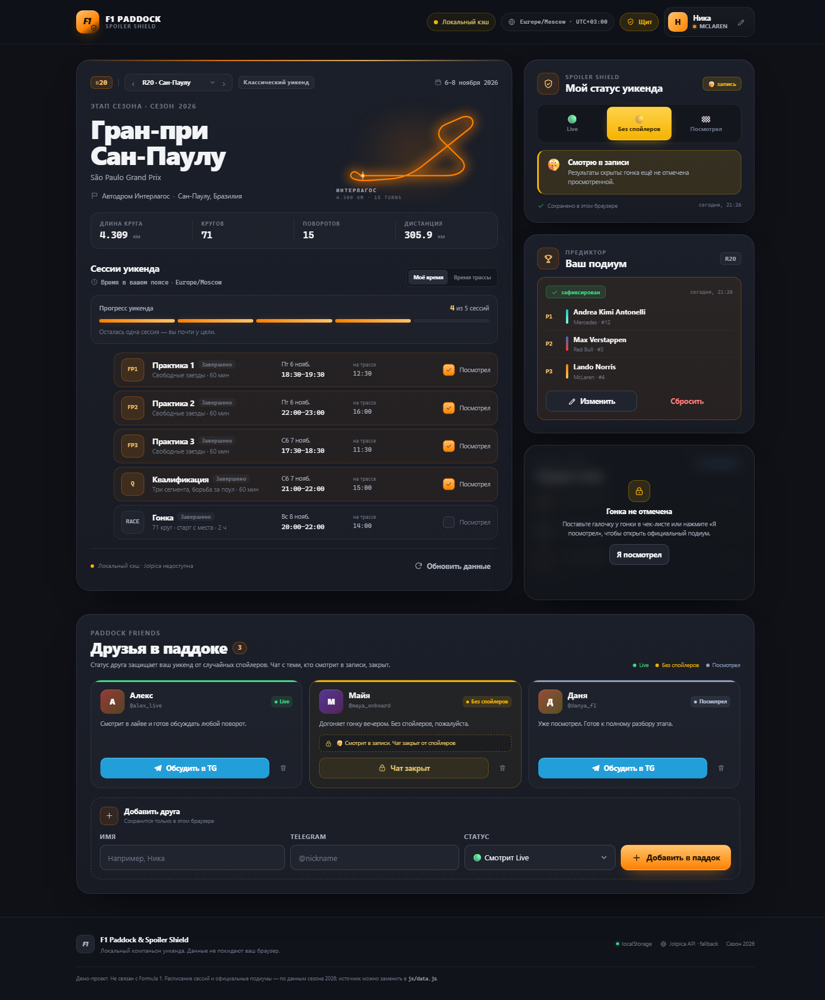

# F1 Paddock & Spoiler Shield

Сезонный компаньон Формулы-1: 23 этапа 2026 года, время в вашем поясе или на трассе, защита от спойлеров, друзья в паддоке и прогнозы подиума по каждому Гран-при.



## Быстрый запуск

```powershell
cd "C:\Users\oklli\Downloads\deepseek harness"
py -m http.server 5173 --bind 127.0.0.1
```

Откройте: **http://localhost:5173/**

Остановка — `Ctrl+C`. Сборка, `npm install` и интернет не нужны.

Если `py` не найден:

```powershell
python -m http.server 5173 --bind 127.0.0.1
```

Можно открыть `index.html` напрямую (`start index.html`), но API-запрос может быть заблокирован браузером — сработает локальный fallback. Для полноценной проверки используйте локальный сервер.

## Что нового в v1.1

- **23 этапа сезона-2026** с переключением в карточке Гран-при: список + кнопки «предыдущий/следующий». Выбранный этап сохраняется.
- **Реальные подиумы** 20 завершённых гонок по официальным данным Formula 1. Выдуманный демо-подиум удалён. Сан-Паулу: Норрис — Верстапен — Хаджар.
- **Результаты только после просмотра.** Если гонка прошла, но не отмечена, победители скрыты. Если гонка ещё впереди — блока итогов нет вовсе.
- **«Моё время / Время трассы»** — переключение отображения всех сессий; выбор сохраняется.
- **Прогнозы по каждому этапу** — переключение гонок не перетирает прогнозы.
- **Прямой Telegram-чат:** `https://t.me/<ник>?text=<готовый текст>` — открывается чат с другом, ник берётся из карточки.
- **Серые TG-кнопки** у доступных друзей (Live и Посмотрел). Янтарной остаётся только заблокированная кнопка «в записи».
- **Карты всех 23 трасс** с номерами поворотов и легендой названий: Монако, Спа, Монца, Сильверстоун, Интерлагос и другие.
- **Миграция старой схемы localStorage** — старые сессии и прогноз автоматически переносятся на Сан-Паулу.

## Как менять время

1. **Отображение:** переключатель **«Моё время» / «Время трассы»** в блоке «Сессии уикенда». В режиме трассы главное время — местное для автодрома, дополнительное — ваше; в локальном режиме наоборот.
2. **Этап:** выберите другой Гран-при в селекторе — расписание, даты и часовой пояс подтянутся из данных этапа.
3. **Сами часы сессии:** откройте `js/data.js`, найдите нужный этап в `F1_DATA.races` и измените `start` у сессии. Время хранится в UTC, ISO 8601: `"2026-11-08T17:00:00Z"`. После сохранения обновите страницу.

## Трассы и повороты

- В карточке этапа есть **схема трассы для каждого из 23 Гран-при** — с номерами поворотов, секторами и зонами обгона.
- Кнопка **«Названия поворотов»** открывает большую схему и легенду: номер/диапазон → историческое название.
- Названия собраны из открытых источников и проверены по официальным материалам: Formula 1 (Хунгароринг-2026), Wikipedia, RacingCircuits.info, JetPunk. Подробнее — [CREDITS.md](CREDITS.md).
- Для трасс без устоявшихся названий (Альберт-Парк, Шанхай, Майами, Мадринг, Сепанг, Лас-Вегас, Лусаил, Яс-Марина) показывается подсказка ориентироваться по номерам.
- Схемы — официальные карты Formula 1, сохранённые локально в `assets/tracks/`; приложение работает офлайн. Права принадлежат Formula 1, проект некоммерческий.

## Календарь и результаты

- 23 этапа: Австралия → Абу-Даби; раунд 20 — Сан-Паулу, 21 — Лас-Вегас, 22 — Катар, 23 — Абу-Даби.
- 20 завершённых гонок имеют официальный подиум; у 21–23 результатов нет, и блок итогов для них скрыт.
- Спринт-уикенды содержат 5 сессий: FP1, спринт-квалификация, спринт, квалификация, гонка.
- Схемы трасс доступны для всех 23 этапов; номера поворотов соответствуют официальным картам.

### Логика Spoiler Shield

| Ситуация | Что видно |
|---|---|
| Гонка ещё не завершилась | Блока итогов нет |
| Гонка прошла, но не отмечена | Подиум скрыт, кнопка «Я посмотрел» |
| Гонка отмечена, статус «Без спойлеров» | Подиум скрыт, кнопка «Открыть итоги» |
| Гонка отмечена, статус Live/Посмотрел | Официальный подиум |

Официальный подиум всегда помечен тегом **Formula 1** и подписью «Официальный результат».

## Telegram и друзья

- **Live** и **Посмотрел** — одинаковая **серая плашка** «Обсудить в TG» с Telegram-иконкой; открывается личный чат с ником из карточки и предзаполненным текстом.
- **Без спойлеров** — янтарная защитная карточка и заблокированная кнопка с замком; чат недоступен. Янтарный цвет здесь означает защиту, а не другой вариант действия.
- Ссылка вида `https://t.me/alex_live?text=...`; если ник не указан, используется `t.me/share/url`.
- Добавление, удаление и undo-тост сохраняются в браузере.

> Примечание: Telegram сам решает, подставлять ли `?text=` в веб-клиенте. Ссылка в любом случае ведёт прямо в чат с нужным ником.

## localStorage

| Ключ | Содержимое |
|---|---|
| `f1_profile` | Имя, команда, флаг онбординга |
| `f1_user_status` | `live` / `recording` / `watched` |
| `f1_sessions` | Отметки по каждому этапу |
| `f1_friends` | Друзья |
| `f1_predictions` | Прогнозы по каждому этапу |
| `f1_selected_race` | Выбранный Гран-при |
| `f1_prefs` | Режим времени: `local` / `track` |

Старые плоские `f1_sessions` и одиночный прогноз автоматически мигрируют в новую схему с привязкой к `2026-brazil`.

## Структура

```text
.
├── index.html
├── css/styles.css
├── js/
│   ├── data.js        # 23 этапа, 22 пилота, 11 команд, официальные подиумы
│   ├── storage.js     # localStorage + миграции + memory-fallback
│   └── app.js         # рендер, сезон, время, Spoiler Shield, API
├── screenshots/
├── PRD.md
├── DESIGN.md
└── README.md
```

## Источник данных и API

- Jolpica: `https://api.jolpica.net/ergast/f1/current.json`, таймаут **2000 мс**, `AbortController`.
- Сначала рендерится локальный снимок, API лишь подтверждает сезон/раунд; интерфейс не блокируется.
- При недоступности API — индикатор «Локальный кэш».
- Официальные подиумы и расписание собраны из данных сезона-2026; для будущих гонок результаты намеренно отсутствуют.

## Проверено

- Переключение 23 этапов, спринт- и классические уикенды.
- Реальные подиумы: Сан-Паулу — Норрис / Верстапен / Хаджар; Канада — Антонелли / Хэмилтон / Верстапен.
- Блокировка результатов до отметки гонки и полное отсутствие блока для будущих этапов.
- Переключение «Моё время / Время трассы» и сохранение режима после F5.
- Прогнозы отдельно для Сан-Паулу и Лас-Вегаса; переключение этапов не перетирает данные.
- Прямые Telegram-ссылки с ником друга.
- Миграция старой схемы localStorage.
- Восстановление этапа, времени, сессий, прогнозов и статуса после перезагрузки.
- Ширины 360, 390, 768, 1024, 1440 px — без горизонтального переполнения; ошибок в консоли нет.

## Осознанные ограничения

- Статический снимок: результаты Лас-Вегаса, Катара и Абу-Даби появятся только после обновления `js/data.js`.
- Нет бэкенда, аккаунтов и синхронизации между устройствами.
- Нет live timing и WebSocket.
- Нет редактора расписания в UI: время меняется в `js/data.js` или переключением этапа.
- Клиентский Spoiler Shield — UX-защита, а не security-boundary.

## Почему без Tailwind CDN

Приложение должно запускаться офлайн без сборщика. Tailwind Play CDN компилирует стили в браузере и без интернета ломает внешний вид. Используется собственная CSS-дизайн-система с Tailwind-совместимыми токенами; при переходе на Vite + Tailwind они переносятся в `theme.extend` без изменения визуала. Подробнее — `DESIGN.md`, раздел 9.

## Документация

- [PRD.md](PRD.md) — продукт, сценарии, схема данных.
- [DESIGN.md](DESIGN.md) — дизайн-система, компоненты, адаптивность.
- [screenshots/desktop.png](screenshots/desktop.png), [screenshots/mobile.png](screenshots/mobile.png), [screenshots/results.png](screenshots/results.png), [screenshots/onboarding-mobile.png](screenshots/onboarding-mobile.png) — превью.
