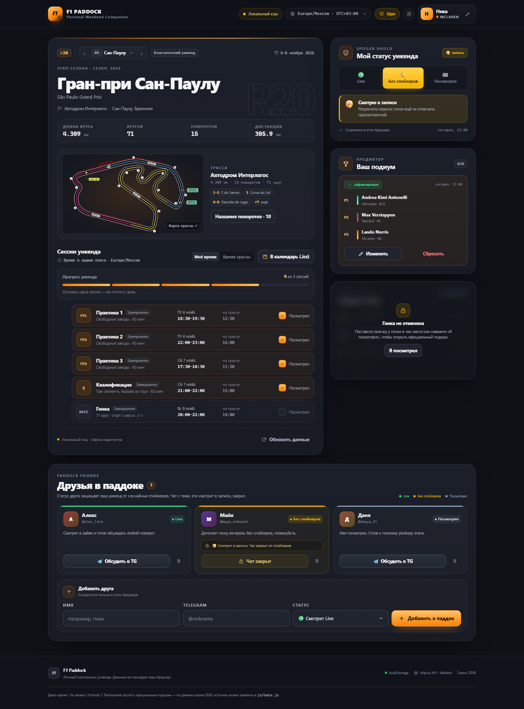

# F1 Paddock

Сезонный компаньон Формулы-1: 23 этапа сезона-2026, время в вашем поясе или на трассе, защита от спойлеров, друзья в паддоке, прогнозы подиума, демо-вход через Telegram и светлая/тёмная тема с подстройкой под систему.



## Быстрый запуск

```powershell
cd "путь-к-папке-проекта"
py -m http.server 5173
```

Откройте: **http://localhost:5173/**

Остановка — `Ctrl+C`. Сборка, `npm install` и интернет не нужны.

Если `py` не найден:

```powershell
python -m http.server 5173
```

Сервер слушает все интерфейсы. Чтобы ограничить доступ локальной машиной, добавьте `--bind 127.0.0.1`.

Можно открыть `index.html` напрямую (`start index.html`), но API-запрос может быть заблокирован браузером — сработает локальный fallback. Для полноценной проверки используйте локальный сервер.

## Что нового в v1.2

- **Демо-вход через Telegram:** ник → четырёхзначный код → имя и любимая команда. В демо-режиме сообщение не отправляется, код от `@F1PaddockBot` всегда `1234`, проверка идёт в браузере.
- **Гостевая шапка:** «Войти через Telegram» на первом экране и в шапке; гостю доступны все функции, а прогнозы, друзья и тема остаются в браузере.
- **Профиль аккаунта:** после входа шапка показывает имя, команду и `@username`; модалка позволяет изменить имя/команду или выйти. Выход не удаляет прогнозы, сессии, статус, друзей и настройки.
- **Системная тема до первого выбора:** пока `f1_prefs.theme === null`, интерфейс следует `prefers-color-scheme` и обновляется при смене темы в ОС. Ручное переключение фиксирует `dark`/`light` навсегда.
- **Совместимость:** старый `f1_profile` без Telegram-полей читается как гостевой профиль, имя и команда сохраняются.

## Что нового в v1.1

- **Светлая и тёмная темы** с переключателем солнце/луна в шапке. Явный выбор хранится в `f1_prefs.theme`, применяется атрибутом `data-theme` до первой отрисовки и переживает F5 без вспышки чужой темы.
- **23 этапа сезона-2026** с переключением в карточке Гран-при: список + кнопки «предыдущий/следующий». Выбранный этап сохраняется.
- **Реальные подиумы** 20 завершённых гонок по официальным данным Formula 1. Выдуманный демо-подиум удалён. Сан-Паулу: Норрис — Верстапен — Хаджар.
- **Результаты только после просмотра.** Если гонка прошла, но не отмечена, победители скрыты. Если гонка ещё впереди — блока итогов нет вовсе.
- **«Моё время / Время трассы»** — переключение отображения всех сессий; выбор сохраняется.
- **Экспорт этапа в календарь (.ics)** — кнопка в блоке сессий скачивает iCalendar-файл со всеми сессиями в UTC.
- **Прогнозы по каждому этапу** — переключение гонок не перетирает прогнозы.
- **Прямой Telegram-чат:** `https://t.me/<ник>?text=<готовый текст>` — открывается чат с другом, ник берётся из карточки.
- **Серые TG-кнопки** у доступных друзей (Live и Посмотрел). Янтарной остаётся только заблокированная кнопка «в записи».
- **Карты всех 23 трасс** с номерами поворотов и легендой названий: Монако, Спа, Монца, Сильверстоун, Интерлагос и другие.
- **Миграция старой схемы localStorage** — старые сессии и прогноз автоматически переносятся на Сан-Паулу.

## Вход через Telegram (демо)

1. На первом запуске откроется приветствие: **«Войти через Telegram»** или **«Продолжить как гость»**. Позже гостевая кнопка в шапке сразу открывает шаг с ником.
2. Введите `@username` (латиница, цифры, `_`, от 5 до 32 символов). Формат проверяется на клиенте, ник демо-бота `@F1PaddockBot` запрещён.
3. Введите четырёхзначный код. Реального сообщения нет: подсказка в модалке и тост напоминают, что код от `@F1PaddockBot` — **`1234`**. Неверный код показывает ошибку и не создаёт сессию.
4. После верного кода сессия сохраняется сразу, а третий шаг предлагает имя и одну из 11 команд. Имя и команда сохраняются отдельно; акцент команды применяется сразу.
5. Шапка показывает имя, команду и `@username`. В модалке можно изменить данные или нажать **«Выйти»** — выход в один клик, с информационным тостом; прогнозы, отметки, друзья и настройки остаются.

Код хранится только в `js/app.js` и никогда не пишется в `localStorage`. Это прототипный слой: реального Telegram Bot API, сервера и паролей нет, `@username` не проверяется на существование. Схема готова к замене клиентской проверки на серверную.

## Тема

- Переключатель — компактная кнопка с иконкой солнца или луны рядом с профилем в шапке.
- Пока пользователь не выбрал тему вручную, `f1_prefs.theme === null`: приложение следует системной `prefers-color-scheme` и реагирует на её изменение. После первого нажатия сохраняется явный `dark` или `light`.
- Светлая тема использует тёплый фон `#F4F3F0`, белые карточки, графитовый текст и тонкие границы.
- Обе темы используют одну сетку токенов: меняются значения CSS-переменных и `data-theme` на `<html>`. Pre-paint скрипт разрешает тему до первой отрисовки, поэтому вспышки нет.
- Схемы трасс в светлой теме инвертируются CSS-фильтром (`invert(0.92) hue-rotate(180deg) contrast(1.05)`): подложка становится светлой, а номера поворотов, подписи секторов и зоны обгона остаются читаемыми.

## Как менять время

1. **Отображение:** переключатель **«Моё время» / «Время трассы»** в блоке «Сессии уикенда». В режиме трассы главное время — местное для автодрома, дополнительное — ваше; в локальном режиме наоборот.
2. **Этап:** выберите другой Гран-при в списке этапов — расписание, даты и часовой пояс подтянутся из данных этапа.
3. **Сами часы сессии:** откройте `js/data.js`, найдите нужный этап в `F1_DATA.races` и измените `start` у сессии. Время хранится в UTC, ISO 8601: `"2026-11-08T17:00:00Z"`. После сохранения обновите страницу.

## Трассы и повороты

- В карточке этапа есть **схема трассы для каждого из 23 Гран-при** — с номерами поворотов, секторами и зонами обгона.
- Кнопка **«Названия поворотов»** открывает большую схему и легенду: номер/диапазон → историческое название.
- Названия собраны из открытых источников и проверены по официальным материалам: Formula 1 (Хунгароринг-2026), Wikipedia, RacingCircuits.info, JetPunk. Подробнее — [CREDITS.md](CREDITS.md).
- Для трасс без устоявшихся названий (Альберт-Парк, Шанхай, Майами, Мадринг, Сепанг, Лас-Вегас, Лусаил, Яс-Марина) показывается подсказка ориентироваться по номерам.
- Схемы — официальные карты Formula 1, сохранённые локально в `assets/tracks/`; приложение работает офлайн. Права принадлежат Formula 1, проект некоммерческий.

## Календарь и результаты

- 23 этапа: Австралия → Абу-Даби; раунд 20 — Сан-Паулу, 21 — Лас-Вегас, 22 — Катар, 23 — Абу-Даби.
- 20 завершённых гонок имеют официальный подиум; у 21–23 результатов нет, и блок итогов для них скрыт.
- Спринт-уикенды содержат 5 сессий: FP1, спринт-квалификация, спринт, квалификация, гонка.
- Схемы трасс доступны для всех 23 этапов; номера поворотов соответствуют официальным картам.

### Логика Spoiler Shield

| Ситуация | Что видно |
|---|---|
| Гонка ещё не завершилась | Блока итогов нет |
| Гонка прошла, но не отмечена | Подиум скрыт, кнопка «Я посмотрел» |
| Гонка отмечена, статус «Без спойлеров» | Подиум скрыт, кнопка «Открыть итоги» |
| Гонка отмечена, статус Live/Посмотрел | Официальный подиум |

Официальный подиум всегда помечен тегом **Formula 1** и подписью «Официальный результат».

## Telegram и друзья

- **Live** и **Посмотрел** — одинаковая **серая плашка** «Обсудить в TG» с Telegram-иконкой; открывается личный чат с ником из карточки и предзаполненным текстом.
- **Без спойлеров** — янтарная защитная карточка и заблокированная кнопка с замком; чат недоступен. Янтарный цвет здесь означает защиту, а не другой вариант действия.
- Ссылка вида `https://t.me/alex_live?text=...`; если ник не указан, используется `t.me/share/url`.
- Добавление, удаление и undo-тост сохраняются в браузере.

> Примечание: Telegram сам решает, подставлять ли `?text=` в веб-клиенте. Ссылка в любом случае ведёт прямо в чат с нужным ником.

## localStorage

| Ключ | Содержимое |
|---|---|
| `f1_profile` | `name`, `team`, `onboarded`, `updatedAt`, `telegram: "@ник" \| null`, `authMethod: "telegram-mock" \| null`, `signedInAt: ISO \| null` |
| `f1_user_status` | `live` / `recording` / `watched` |
| `f1_sessions` | Отметки по каждому этапу |
| `f1_friends` | Друзья |
| `f1_predictions` | Прогнозы по каждому этапу |
| `f1_selected_race` | Выбранный Гран-при |
| `f1_prefs` | `timeMode: "local" \| "track"`, `userTimezone: string \| null`, `theme: "dark" \| "light" \| null` |

`theme: null` означает «следовать системе»; `telegram: null` — гостевой режим. Старые записи `f1_profile` без Telegram-полей читаются как гостевые, имя и команда при этом сохраняются. Старые плоские `f1_sessions` и одиночный прогноз автоматически мигрируют в новую схему с привязкой к `2026-brazil`. Если localStorage недоступен, приложение работает на memory-fallback в пределах вкладки.

## Структура

```text
.
├── index.html
├── css/styles.css
├── js/
│   ├── data.js        # 23 этапа, 22 пилота, 11 команд, официальные подиумы
│   ├── tracks.js      # схемы трасс и названия поворотов
│   ├── storage.js     # localStorage + миграции + memory-fallback
│   └── app.js         # рендер, сезон, время, тема, вход, Spoiler Shield, API
├── assets/tracks/     # 23 схемы трасс в .webp
├── screenshots/       # desktop, mobile, results, onboarding-mobile
├── ref-desktop-1.png  # десктопный референс
├── ref-desktop-2.png  # десктопный референс
├── .gitignore
├── AGENTS.md
├── ARCHITECTURE.md
├── PRD.md
├── DESIGN.md
├── CREDITS.md
└── README.md
```

## Источник данных и API

- Jolpica: `https://api.jolpica.net/ergast/f1/current.json`, таймаут запроса **2000 мс**, fallback-таймер **2800 мс**, `AbortController`.
- Сначала рендерится локальный снимок, API лишь подтверждает сезон и первый этап таблицы; интерфейс не блокируется.
- При недоступности API — индикатор «Локальный кэш».
- Официальные подиумы и расписание собраны из данных сезона-2026; для будущих гонок результаты намеренно отсутствуют.

## Проверено

- Переключение 23 этапов, спринт- и классические уикенды.
- Реальные подиумы: Сан-Паулу — Норрис / Верстапен / Хаджар; Канада — Антонелли / Хэмилтон / Верстапен.
- Блокировка результатов до отметки гонки и полное отсутствие блока для будущих этапов.
- Переключение «Моё время / Время трассы» и сохранение режима после F5.
- Скачивание `.ics` со всеми сессиями этапа в UTC.
- Переключение светлой/тёмной темы, сохранение выбора после F5 и отсутствие вспышки темы при загрузке.
- Системная тема при `theme: null`: светлая система → светлый интерфейс; ручное переключение сохраняет `dark`/`light`.
- Полный цикл входа: гость → `@test_user` → неверный код → `1234` → имя и McLaren → F5 → выход; прогнозы, сессии, статус, друзья и тема после выхода сохраняются.
- Повторный вход после выхода подставляет сохранённые имя и команду; старый профиль без Telegram-полей и повреждённые значения ника читаются как гостевые.
- Прогнозы отдельно для Сан-Паулу и Лас-Вегаса; переключение этапов не перетирает данные.
- Прямые Telegram-ссылки с ником друга.
- Миграция старой схемы localStorage.
- Восстановление этапа, времени, сессий, прогнозов, статуса и темы после перезагрузки.
- Ширины 360, 390, 768, 1024, 1440 px в обеих темах — без горизонтального переполнения; ошибок в консоли нет.
- Полировка модалки: степпер скрыт в редакторе авторизованного профиля, primary-кнопки без градиента и цветного свечения, кнопка «Получить код в Telegram» спокойная в обеих темах, иконка Telegram контурная, поле кода в масштабе остальных инпутов. Проверено на ливреях Ferrari, McLaren и Racing Bulls при 360 px.

## Осознанные ограничения

- Статический снимок: результаты Лас-Вегаса, Катара и Абу-Даби появятся только после обновления `js/data.js`.
- Нет бэкенда, реальных аккаунтов и синхронизации между устройствами. Вход через Telegram — демо: код `1234` проверяется в браузере, сообщения не отправляются, ник не проверяется.
- Нет реальной авторизации и защиты аккаунта: любой скрипт на этом origin может прочитать `f1_profile`, а очистка данных сайта «разлогинивает».
- Нет live timing и WebSocket.
- Нет редактора расписания в UI: время меняется в `js/data.js` или переключением этапа.
- Клиентский Spoiler Shield — UX-защита, а не security-boundary.
- Тема и остальные настройки живут только в этом браузере и профиле; очистка данных сайта сбрасывает их к значениям по умолчанию.

## Почему без Tailwind CDN

Приложение должно запускаться офлайн без сборщика. Tailwind Play CDN компилирует стили в браузере и без интернета ломает внешний вид. Используется собственная CSS-дизайн-система с Tailwind-совместимыми токенами; при переходе на Vite + Tailwind они переносятся в `theme.extend` без изменения визуала. Подробнее — `DESIGN.md`, раздел 9.

## Документация

- [AGENTS.md](AGENTS.md) — правила работы агента с проектом.
- [ARCHITECTURE.md](ARCHITECTURE.md) — фактическая архитектура, схема данных и ограничения.
- [PRD.md](PRD.md) — продукт, сценарии, схема данных.
- [DESIGN.md](DESIGN.md) — дизайн-система, компоненты, адаптивность, темы.
- [CREDITS.md](CREDITS.md) — источники схем трасс, названий поворотов и данных.
- [screenshots/desktop.png](screenshots/desktop.png), [screenshots/mobile.png](screenshots/mobile.png), [screenshots/results.png](screenshots/results.png), [screenshots/onboarding-mobile.png](screenshots/onboarding-mobile.png) — превью.
